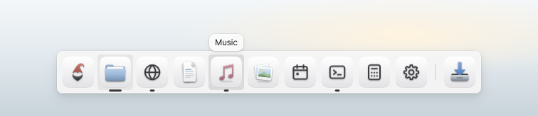
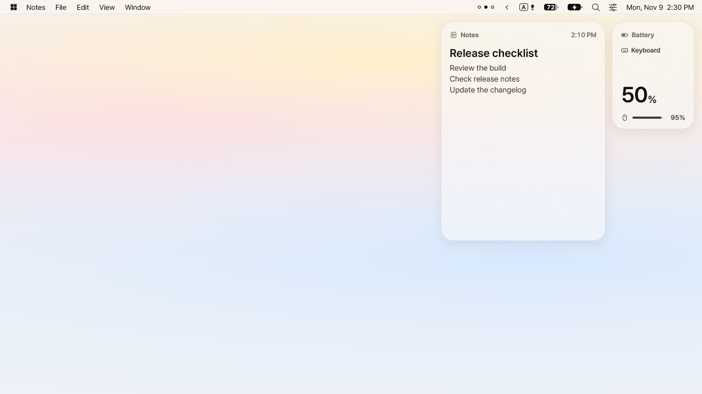
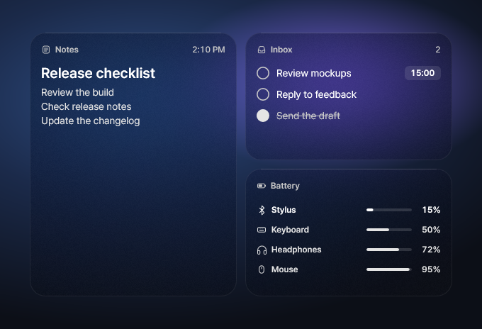

<p align="center">
  
</p>

<h1 align="center">NopBar</h1>

<p align="center">A free, open-source dock and top bar for Windows, built in Rust.</p>

<p align="center">
  <a href="https://github.com/nopbard/nopbar-releases/releases/latest">Download</a> ·
  <a href="https://nopbard.com/nopbar">Website</a> ·
  <a href="https://nopbard.com/nopbar/help">Help</a> ·
  <a href="https://github.com/sponsors/nopbard">Sponsor</a> ·
  <a href="#build-from-source">Build from source</a>
</p>

## Features

- **Dock**. Pin apps, switch between windows with previews and jump lists,
  and move keyboard focus to the dock with Win+T. Put a dock on every monitor
  or choose which monitors show it. Dock icons support magnification, activity
  indicators, and folder stacks.
- **Top bar**. The glass automatically adjusts to the brightness beneath it.
  Open the system tray and use Quick Settings to list Wi-Fi networks,
  Bluetooth devices, and accessibility options and switch them directly.
- **Desktop widgets**. Keep notes, see device battery levels, and open
  your note inbox. Arrange and resize widgets by dragging them on the grid.
- **Gnome**. Use the desktop assistant for briefings, an end-of-day review,
  and notifications.

## Screenshots







## Install

Requires Windows 10 22H2 (build 19045) or Windows 11, x64.

- **Installer**. Download `NopBar-<version>-setup.exe` and run it. The
  per-user installer uses `%LOCALAPPDATA%\Programs\NopBar`.
- **Portable**. Extract `NopBar-<version>-portable.zip` and run `nopbar.exe`.

NopBar hides the Windows taskbar while it runs and restores it on exit.
If the taskbar is still hidden, run `nopbar.exe --restore-taskbar`.

## Build from source

On Windows, install the stable Rust MSVC toolchain and the Visual Studio
**Desktop development with C++** workload with the Windows SDK.

```powershell
cargo build --release -p dock -p nopbar-mcp -j 4
cargo test -p dock -j 4
```

The binaries are `target\release\nopbar.exe` and
`target\release\nopbar-mcp.exe`. Run `.\scripts\package.ps1 -Zip` for the
portable archive. The `-Installer` option requires Inno Setup 6.7 or later.
See the [contribution guide](CONTRIBUTING.md) for developer setup.

## License

Copyright (c) 2026 nopbard.

- Source code is licensed under [GPL-3.0-only](LICENSE).
- The [GPL-3.0 section 7 additional permission](assets/LICENSE)
  allows conveying this program combined with the NopBar design assets. It
  grants no rights in the assets themselves.
- The gnome artwork, NopBar logos and icons, device artwork, and README
  images are [all rights reserved](assets/LICENSE). Replace this artwork
  when distributing a modified version.
- Use of the NopBar name follows the [trademark terms](TRADEMARKS.md).
- Third-party components retain their own licenses. See the
  [third-party notices](THIRD_PARTY_NOTICES.md).

## 한국어 소개

NopBar는 Rust로 만든 Windows용 무료 오픈소스 독과 상단 바입니다. 독에서 앱과
창을 전환하고, 상단 바에서 트레이와 빠른 설정을 열 수 있습니다. 바탕 화면에는
메모, 배터리, 받은 메모함 위젯을 배치할 수 있고, 노움이 브리핑과 하루
마무리, 알림을 제공합니다.
